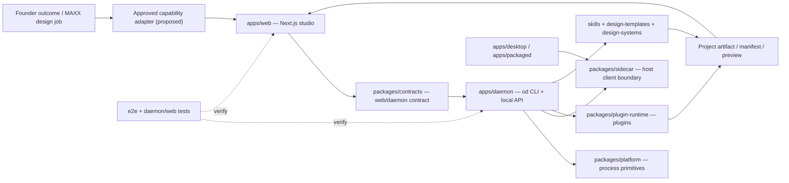

# PARÉ — source-grounded MAXX capability graph

**Status:** code-structure map only; not a claim of production readiness or MAXX integration. Last inspected 2026-11-04. This supplements the authoritative local `AGENTS.md`, `CONTEXT.md` and `docs/architecture.md`; it does not replace them or reorganize a working monorepo.

## Module-to-job routes

| Job | Code to inspect | Proof |
|---|---|---|
| Design project and visual output | `apps/web`, `apps/daemon`, `packages/contracts` | web + daemon tests, artifact manifest |
| Agent/model adapter | `docs/agent-adapters.md`, `apps/daemon`, `packages/launcher-proto` | test environment and model fallback |
| Design systems and skills | `design-systems/`, `skills/`, `design-templates/`, `plugins/` | deterministic output, owner acceptance |
| Desktop distribution | `apps/desktop`, `apps/packaged`, `packages/sidecar`, `tools/pack` | packaged updater tests |
| Public marketing | `apps/landing-page` | separate storefront; not design engine |
| Regression | `e2e/`, `mocks/`, `scripts/guard.ts` | independent run at exact commit |

## MAXX integration boundary

Classify PARÉ as a **design capability**, not a separate client business brain. Hermes/Paperclip may request a scoped design job through a reviewed adapter. MAXX backend owns tenant identity, business truth, approval, cost and evidence. PARÉ owns design project/artifact implementation. Client data stays isolated; no raw exports or secrets in this repository.

**Do not claim ready:** This graph is based on checked-in code and package manifests. No production design run, multi-tenant isolation or commercial entitlement has been verified in this review. Check Apache-2.0 and transitive licenses before distributing bundles.

**Safe next proof:** one synthetic approved brand brief → PARÉ artifact → exported file → MAXX evidence receipt; run `pnpm --filter @open-design/daemon test` and `pnpm --filter @open-design/web test` in a controlled build first.
